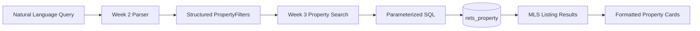

# Week 3 - MLS Database Integration


## Goal


The goal of Week 3 is to connect the Week 2 natural-language property filters to the MySQL MLS databases and return clean, formatted property results.


This week focuses on:


- MySQL connection pooling

- Parameterized SQL queries

- Active listing search

- Sold comparable property queries

- Pagination

- Result formatting

- Integration with the Week 2 parser


## Database Connection


The reusable MySQL connection module is located in:


```text

src/db.ts

```


It uses `mysql2/promise` and environment variables:


```text

MYSQL_HOST

MYSQL_USER

MYSQL_PASSWORD

MYSQL_DATABASE

```


The connection uses a MySQL connection pool and a reusable `query()` helper.


## Active Listing Search


Active listings are queried from:


```text

rets_property

```


The implementation is located in:


```text

src/property-search.ts

```


Supported filters include:

| Filter | Database Column |
|---|---|
| city | `L_City` |
| maxPrice | `L_SystemPrice` |
| beds | `L_Keyword2` |
| baths | `LM_Dec_3` |
| sqft | `LM_Int2_3` |
| type | `L_Type_` |
| pool | `PoolPrivateYN` |
| hasView | `ViewYN` |
| maxHoa | `AssociationFee` |


All user-provided filter values are passed through SQL placeholders instead of being directly inserted into SQL.


Example:


```sql

AND L_City = ?

AND L_SystemPrice <= ?

```


This keeps the database layer parameterized and safer.


## Pagination


The active listing search supports pagination using:


```text

LIMIT

OFFSET

```


The offset is calculated using:


```text

(page - 1) * limit

```


## Sold Comparables


Sold comparable properties are queried from:


```text

california_sold

```


The implementation is located in:


```text

src/sold-comps.ts

```


The query supports:


- city

- recent month range

- residential property filtering

- newest sold properties first

- maximum of 50 results


## Property Card Formatting


Raw database rows are converted into readable property cards.


Example:


```text

44 Fallbrook, Irvine 92604 | $735,000 | 3 bd / 2 ba | 1,084 sqft | Condominium | 61 days on market | MLS: 1177293155

```


This makes the results easier for downstream OpenClaw agents and communication channels to use.


## Week 2 Integration


The integration layer is located in:


```text

src/property-search-skill.ts

```


It connects the Week 2 parser to the Week 3 database layer.


Flow:




Example input:


```text

Show me 3-bedroom condos in Irvine under $1.5M

```


The integration test successfully returned five matching active listings from the local MLS database.


## Tests


Week 3 includes tests for:


```text

tests/db-connection.test.ts

tests/property-search.test.ts

tests/sold-comps.test.ts

tests/property-search-skill.test.ts

```


Verified results:


- MySQL connection successful

- Active listing query returned real MLS rows

- Sold comparable query returned 50 Irvine sold properties

- Natural-language integration returned 5 formatted property cards


## Week 3 Result


At the end of Week 3, the project can:


1\. Accept structured filters from Week 2.

2\. Query active MLS listings using parameterized SQL.

3\. Query sold comparable properties.

4\. Support result pagination.

5\. Format database rows into readable property cards.

6\. Accept a natural-language property query and return matching MLS property cards end-to-end.

