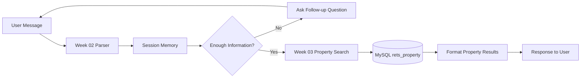

# Week 04 - Conversational Property Search Agent


## Overview


Week 04 extends the Week 03 property search into a multi-turn conversational experience.


The agent can ask follow-up questions, remember user preferences during the session, and refine the property search step by step.


## Example Conversation


```text

User: Find homes in Irvine

Agent: What is your budget?


User: Under $1.2M

Agent: Any preferences - condo, townhome, single family, or land?


User: I want a condo

Agent: How many bedrooms do you need?


User: 3 bedrooms

Agent: [returns matching properties]

```


## Session Memory


The agent remembers:


- City

- Minimum price

- Maximum price

- Bedrooms

- Bathrooms

- Property type

- Pool

- View

- HOA limit

- Previous results


## Run the Demo


From the repository root:


```powershell

npm run chat

```


Commands:


```text

reset

```


Starts a new search.


```text

exit

```


Closes the CLI.


## Tests


Session test:


```powershell

npx tsx week-04/tests/session.test.ts

```


Conversation test:


```powershell

npx tsx week-04/tests/conversation.test.ts

```


## Week 04 Flow





## What I Learned


In Week 04, I learned how to turn a single-turn property search into a multi-turn conversational agent.


The agent can remember previous answers, ask for missing information, refine search preferences, and query the MySQL property database when enough information is available.


